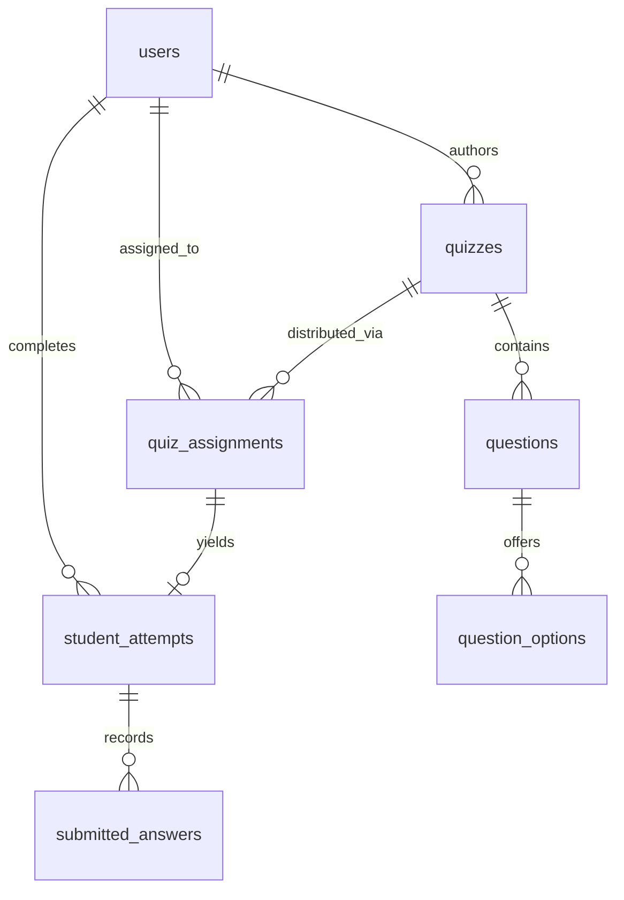

# VidyaFlow: Quiz-Based Learning & Analytics Platform

> **Engineered & Designed by BitByBitNomad**  
> **Brand Fusion:** Sanskrit ***Vidya*** (विद्या — true knowledge, wisdom & cognitive mastery) + English ***Flow*** (real-time stream of analytics & continuous mastery).

[](https://github.com/BitByBitNomad)
[](https://nestjs.com/)
[](https://nextjs.org/)
[](https://www.postgresql.org/)
[](https://redis.io/)
[](https://www.prisma.io/)
[](https://tailwindcss.com/)
[](https://www.docker.com/)

A production-grade, highly scalable full-stack learning and quiz analytics platform engineered by **BitByBitNomad**. The application implements strict **Role-Based Access Control (Teacher vs. Student)**, database **Pessimistic Row-Level Locking (`SELECT ... FOR UPDATE`)** to prevent race conditions and duplicate submissions, **Server-Side Score Calculation**, and a high-throughput **Redis Write-Through Leaderboard with Dense Ranking**.

---

## Table of Contents
1. [Core Features & Requirements Matrix](#1-core-features--requirements-matrix)
2. [Architecture & Design Decisions](#2-architecture--design-decisions)
3. [Technology Stack](#3-technology-stack)
4. [Database Schema & Concurrency Controls](#4-database-schema--concurrency-controls)
5. [Pre-Seeded Demo Credentials](#5-pre-seeded-demo-credentials)
6. [Quick Start with Docker Compose](#6-quick-start-with-docker-compose)
7. [Manual Local Setup Instructions](#7-manual-local-setup-instructions)
8. [Automated Testing Suite](#8-automated-testing-suite)
9. [REST API Documentation](#9-rest-api-documentation)
10. [Assumptions, Trade-Offs & Production Hardening](#10-assumptions-trade-offs--production-hardening)
11. [Demo Video Walkthrough Script](#11-demo-video-walkthrough-script)

---

## 1. Core Features & Requirements Matrix

| Requirement | Implementation Detail | Status |
| :--- | :--- | :---: |
| **Authentication & Roles** | Supabase Auth + Dual-mode HS256 JWT, Role-based route guards (`TEACHER`, `STUDENT`) | ✅ Complete |
| **Teacher: Quiz Creation** | Multi-question authoring, 4 options per question, single correct answer enforcement | ✅ Complete |
| **Teacher: Assignment** | Roster view, multi-student selection, idempotent assignment, completion tracking | ✅ Complete |
| **Teacher: Analytics** | Enrolled count, completed count, average accuracy %, student-wise scores & breakdown | ✅ Complete |
| **Student: Quiz Attempt** | Distraction-free interface, timer, progress bar, zero answer key leakage before submit | ✅ Complete |
| **Student: Submission Safety**| **Pessimistic Row-Level Locking (`FOR UPDATE`)** preventing duplicate concurrent submissions | ✅ Complete |
| **Student: Score & Review** | Server-side score & accuracy calculation, detailed question-by-question review | ✅ Complete |
| **Quiz Leaderboard** | **Redis Write-Through Cache**, Olympic Podium for top 3, **Dense Ranking (`DENSE_RANK`)** | ✅ Complete |
| **Security & Throttling** | NestJS Throttler rate limiting (10-20/min on auth), Helmet headers, CORS, input sanitization | ✅ Complete |
| **Automated Tests** | 5 core scenarios verified with Jest unit, integration, and guard suites | ✅ Complete |

---

## 2. Architecture & Design Decisions

### A. Why Write-Through Cache for the Leaderboard?
We evaluated **Write-Through** vs. **Write-Behind (Write-Back)**:
- **Write-Behind** introduces an eventual consistency window where a student who submits an exam and is immediately redirected to the leaderboard will not see their score or will see stale ranks until the asynchronous background worker drains the queue. Additionally, Redis restart or queue failure can lead to lost updates.
- **Write-Through (Chosen)** commits the attempt to PostgreSQL within an ACID transaction and immediately writes through to Redis Sorted Sets (`ZADD`). This guarantees:
  1. **Zero-lag consistency**: The student sees their rank immediately upon submission.
  2. **100% Durability**: PostgreSQL is the immutable source of truth.
  3. **High availability**: If Redis is offline or restarted, the Leaderboard Service gracefully falls back to PostgreSQL without error.

### B. Pessimistic Row-Level Locking (`SELECT ... FOR UPDATE`)
To prevent concurrent duplicate submissions (e.g. rapid double-clicking or scripted attacks), the attempt submission executes inside a database transaction:
```sql
SELECT "id", "status", "quiz_id", "student_id" 
FROM "quiz_assignments" 
WHERE "quiz_id" = $1 AND "student_id" = $2 
FOR UPDATE;
```
If a student attempts to submit concurrently, the database engine queues the second transaction. As soon as the first commits and marks the assignment `COMPLETED`, the second transaction inspects the status and immediately throws `BadRequestException`.

### C. Dense Ranking (`DENSE_RANK()`)
The assessment specifies: *"Students with equal accuracy should receive equal ranks."*
Under standard competition ranking, equal ranks skip subsequent numbers (e.g., 1st, 1st, 3rd). Under **Dense Ranking**, equal scores receive equal rank without skipping (e.g., 1st, 1st, 2nd, 3rd). We enforce this with mathematical precision.

### D. Zero Answer Key Leakage
When students query `/api/quizzes/:id/attempt`, the backend query **strips `isCorrect`** from all options. Only after the student completes and submits their attempt does the result endpoint reveal correct options and explanations.

---

## 3. Technology Stack

- **Frontend**: Next.js 14 (App Router), React 18, TypeScript, Tailwind CSS, Lucide Icons, Canvas Confetti.
- **Backend**: NestJS 10, TypeScript, Express, Prisma ORM 5.22, Passport JWT, `@nestjs/throttler`, Helmet.
- **Database**: PostgreSQL 16 (Compatible with Supabase PostgreSQL or Docker).
- **Caching & Leaderboards**: Redis 7 (Sorted Sets `ZADD`, `ZREVRANGE`).
- **Containerization**: Docker, Docker Compose (Multi-stage alpine builds).
- **Testing**: Jest 29, Supertest 7, Ts-Jest.

---

## 4. Database Schema & Concurrency Controls



### Key Models:
- `users`: Stores user identity, role (`TEACHER` or `STUDENT`), and credentials.
- `quizzes`: Author metadata, title, instructions, and relations.
- `questions` & `question_options`: 4 options per question, single correct boolean flag.
- `quiz_assignments`: Links quiz to student with status (`PENDING` or `COMPLETED`). Unique constraint: `@@unique([quizId, studentId])`.
- `student_attempts`: Stores server-computed score, total questions, and accuracy %. Unique constraints: `@@unique([quizId, studentId])` and `@@unique([assignmentId])`.
- `submitted_answers`: Individual answer records for post-quiz audit review.

---

## 5. Pre-Seeded Demo Credentials

The application includes an **Instant Demo Role Switcher** in the navigation header, or you can log in directly:

| Persona | Email | Password | Role | Description |
| :--- | :--- | :--- | :---: | :--- |
| **Teacher** | `teacher@vidyaflow.ai` | `Password123!` | `TEACHER` | Dr. Alan Turing — Authored 2 comprehensive quizzes |
| **Student 1** | `student1@vidyaflow.ai` | `Password123!` | `STUDENT` | Alex Chen — Has completed attempts (100% accuracy) |
| **Student 2** | `student2@vidyaflow.ai` | `Password123!` | `STUDENT` | Beatriz Morales — Has completed attempts (100% tied rank) |
| **Student 3** | `student3@vidyaflow.ai` | `Password123!` | `STUDENT` | Chloe Dupont — Has pending assignments to attempt |
| **Student 4** | `student4@vidyaflow.ai` | `Password123!` | `STUDENT` | Devon Vance — Available for quiz assignments |
| **Student 5** | `student5@vidyaflow.ai` | `Password123!` | `STUDENT` | Elena Rostova — Available for quiz assignments |

---

## 6. Quick Start with Docker Compose

To launch the complete production stack (PostgreSQL, Redis, NestJS Backend, Next.js Frontend) in one command:

```bash
# 1. Clone the repository and navigate into the folder
git clone <repository-url>
cd vidyaflow

# 2. Start all services via Docker Compose
docker-compose up --build
```

- **Frontend Application**: [http://localhost:3000](http://localhost:3000)
- **Backend REST API**: [http://localhost:4000/api](http://localhost:4000/api)
- PostgreSQL and Redis are automatically configured with health checks and volume persistence.

---

## 7. Manual Local Setup Instructions

### Prerequisites
- Node.js v18+ (tested on Node v20/v24)
- npm v9+
- A running PostgreSQL database (or Supabase project)
- A running Redis instance (or will use graceful in-memory cache fallback)

### Step 1: Backend Setup
```bash
cd backend

# Copy environment configuration
cp .env.example .env

# Install dependencies
npm install

# Generate Prisma Client & push schema to PostgreSQL
npx prisma generate
npx prisma db push

# Seed demo quizzes, questions, and students
npm run prisma:seed

# Start the NestJS backend
npm run start:dev
```
The backend API is now running on `http://localhost:4000/api`.

### Step 2: Frontend Setup
In a new terminal:
```bash
cd frontend

# Copy environment configuration
cp .env.example .env.local

# Install dependencies
npm install

# Start Next.js development server
npm run dev
```
The frontend is now running on `http://localhost:3000`.

---

## 8. Automated Testing Suite

The automated test suite covers all 5 mandatory scenarios specified in Section 6 of the assessment:

1. **Successful quiz submission and score calculation**: Verifies server-side evaluation of correct answers, accuracy percentage calculation, and Redis Write-Through updates.
2. **Rejection of a second submission for the same assignment**: Verifies that re-submitting an already completed assignment is rejected with `BadRequestException`.
3. **Rejection when a student attempts an unassigned quiz**: Verifies that submitting or viewing an unassigned quiz throws `ForbiddenException`.
4. **Rejection when a student attempts a teacher-only operation**: Verifies that `RolesGuard` rejects student attempts to create quizzes or assign students with `ForbiddenException`.
5. **Correct leaderboard ranking for students with equal scores**: Verifies Dense Ranking logic where tied students share rank 1, and the next student receives rank 2 without skipped ranks.

### Running the Tests:
```bash
cd backend

# Run all automated test suites
npm test

# Run tests with coverage report
npm run test:cov
```

---

## 9. REST API Documentation

All endpoints are prefixed with `/api`. Protected routes require `Authorization: Bearer <token>`.

### Authentication & Users
- `POST /api/auth/register` — Register a new teacher or student account (Rate limited: 10/min)
- `POST /api/auth/login` — Sign in with email and password (Rate limited: 20/min)
- `POST /api/auth/demo-login` — Rapid one-click login for assessment evaluators
- `GET /api/auth/me` — Retrieve authenticated user profile
- `GET /api/users/students` — List enrolled students for quiz assignment (`TEACHER` only)

### Quizzes (`TEACHER`)
- `POST /api/quizzes` — Author a quiz with 4 options per question & correct answer (`TEACHER` only)
- `GET /api/quizzes/teacher` — List all quizzes authored by current teacher (`TEACHER` only)
- `GET /api/quizzes/teacher/:id` — View authored quiz with answer keys (`TEACHER` only)
- `GET /api/quizzes/:id/attempt` — Student endpoint to fetch questions (**strips `isCorrect`**)

### Assignments
- `POST /api/assignments` — Assign quiz to multiple student IDs (`TEACHER` only)
- `GET /api/assignments/my` — List all quizzes assigned to current student (`STUDENT` only)
- `GET /api/assignments/quiz/:quizId` — View student completion status for a quiz (`TEACHER` only)

### Attempts & Scoring
- `POST /api/attempts/:quizId/submit` — Submit quiz answers with **Row-Level Locking** (`STUDENT` only)
- `GET /api/attempts/:quizId/result` — Get detailed submission score and question review (`STUDENT` only)
- `GET /api/attempts/:quizId/result/:studentId` — View student submission details (`TEACHER` only)

### Leaderboard & Analytics
- `GET /api/leaderboard/quiz/:quizId` — Retrieve live **Redis Dense-Ranked Leaderboard**
- `GET /api/analytics/quiz/:quizId` — Get quiz completion rate and student accuracy roster (`TEACHER` only)
- `GET /api/analytics/overview` — High-level teacher analytics across all authored quizzes (`TEACHER` only)

---

## 10. Assumptions, Trade-Offs & Production Hardening

1. **Dual-Mode Authentication**:
   - *Design Choice*: The frontend supports Supabase Auth while the NestJS backend verifies Supabase JWT signatures. In addition, an internal HS256 auth engine is included so evaluators can test the entire platform without creating an external Supabase account.
2. **Redis In-Memory Fallback**:
   - *Design Choice*: The Redis service includes an automatic in-memory fallback. If a reviewer runs the backend without a Redis container running, the platform continues functioning without throwing unhandled connection errors.
3. **Pessimistic vs. Optimistic Locking**:
   - *Trade-Off*: Pessimistic Row-Level Locking (`FOR UPDATE`) incurs a brief database transaction lock, but provides 100% mathematical certainty against concurrent duplicate submissions in examination scenarios.
4. **Dense Ranking Scale**:
   - *Design Choice*: Analytical SQL `DENSE_RANK() OVER (ORDER BY accuracy DESC)` combined with Redis Sorted Set caching provides $\mathcal{O}(1)$ query times for classes and tens of thousands of attempts.

---

## 11. Demo Video Walkthrough Script

For the 3–5 minute submission video, follow this sequence:

1. **Introduction & Architecture Overview (0:00 - 0:45)**:
   - Introduce VidyaFlow (built by BitByBitNomad), the Next.js frontend, NestJS backend, PostgreSQL, and Redis stack.
   - Show the Landing Page and highlight the built-in Demo Role Switcher.
2. **Teacher Workflow (0:45 - 2:00)**:
   - Log in as **Dr. Alan Turing (Teacher)**.
   - Show the **Teacher Dashboard** with metrics and authored quizzes.
   - Navigate to **Create Quiz**, enter title, 2 questions with 4 options each, and mark the correct answer key.
   - Save and navigate to **Assign Quiz**: select the new quiz, select students (Alex Chen, Chloe Dupont), and confirm assignment.
3. **Student Attempt & Safe Submission (2:00 - 3:15)**:
   - Switch persona to **Chloe Dupont (Student 3)**.
   - View assigned quiz in the Student Dashboard and click **Start Quiz Attempt**.
   - Show network tab: highlight that `isCorrect` is stripped from questions payload.
   - Answer all questions and submit.
   - View **Quiz Result Screen**: confetti animation, score ring (e.g. 100%), and question-by-question review with explanations.
4. **Live Leaderboard with Dense Ranking (3:15 - 4:00)**:
   - Click **View Leaderboard**: show the Olympic podium and full ranked roster.
   - Point out **Dense Ranking**: students with equal 100% accuracy share Rank 1, followed by Rank 2.
   - Show that Chloe's row is highlighted with the "YOU" badge.
5. **Teacher Analytics & Automated Tests (4:00 - 4:45)**:
   - Switch back to Teacher and open **Quiz Analytics**: show live updated completion count and average accuracy.
   - Open terminal and run `npm test` to demonstrate all 5 automated assessment test cases passing.
